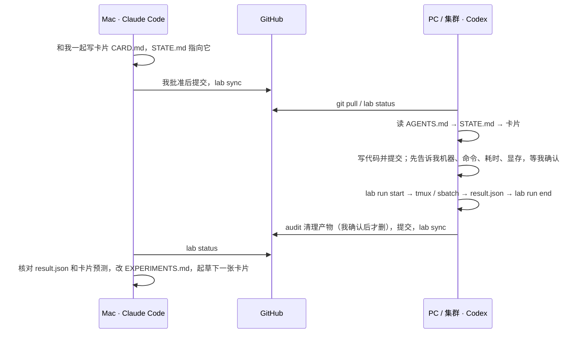

# research_workplace

这个仓库放我的多个研究子项目，coding agent 按同一套流程来执行。

- 计划在 Mac 上和 Claude Code 一起写。
- 计划写成 git 里的实验卡片，PC 或集群上的 Codex 拉取后执行。
- 结果也通过 git 回到 Mac，由我核对，再决定下一步。

规则见 [AGENTS.md](AGENTS.md)，每个子项目还有自己的 AGENTS.md。项目的组织方法来自 skill `research-project`，三台机器的分工来自 skill `lab-machines`。这两个 skill 不会自动加载，在这个仓库里由 AGENTS.md 按路径引用。

## 理想的目录结构

```text
research_workplace/
├── AGENTS.md                  总仓库规则：一次只做一个子项目，子项目互不依赖
├── CLAUDE.md                  → @AGENTS.md
├── README.md                  本文件，以及下面的子项目索引
├── .lab/runs/                 所有子项目的运行记录（lab 命令写，哪台机器、哪个 commit、产物在哪）
│
├── paper_repro/               复现论文
│   ├── repa/                  一个子项目（下面展开）
│   └── rae/
│
└── idea_verify/               验证自己的想法
    └── <想法名>/

paper_repro/repa/              每个子项目都由模板生成，结构相同
├── AGENTS.md                  子项目规则（≤80 行），优先于根目录的规则
├── CLAUDE.md                  → @AGENTS.md
├── STATE.md                   当前主干、当前唯一问题、排队、搁置的想法（≤40 行）
├── EXPERIMENTS.md             所有实验，每个一行结论
├── docs/
│   ├── PROJECT.md             目标、背景、已有结论
│   ├── DATA.md                数据来源、契约、划分
│   ├── PIPELINE.md            数据 → 训练 → 推理 → 评测的命令，唯一的评测入口
│   └── DECISIONS.md           决策及理由
├── configs/
│   ├── trunk.yaml             主干配置
│   └── exp/<id>.yaml          实验配置，只写相对主干的差异
├── src/repa/                  主干代码，一个子项目只有一个包
│   └── artifacts.py           保存 checkpoint 和缓存的唯一入口（只留 best.pt 和 last.pt）
├── experiments/<id>/
│   ├── CARD.md                实验卡片：问题、预测、推翻条件、预算、要保存的产物
│   ├── result.json            指标、commit、run_id、大产物在哪台机器的哪里
│   └── *.png                  最多 4 张图
├── tests/
├── tools/
│   ├── project.py             模板工具：new / check / audit / prune
│   └── env.sh                 运行前 source：缓存进临时目录，权重进共享目录
├── runs/                      不进 git：各机器自己的 checkpoint、推理结果、代码快照
└── scratch/                   不进 git：smoke 运行和临时文件
```

**进 git 的只有：** 代码、配置、文档、卡片、`result.json` 和少量图。

**不进 git 的：**
- checkpoint、缓存和数据，留在产生它们的机器上，路径写进 `result.json`；
- 数据集和预训练权重，放在各机器登记好的共享目录里，不复制进子项目。

## 三台机器

| 机器 | 角色 | 本仓库位置 |
|---|---|---|
| Mac | 指挥台：写计划、写代码、分析结果；只跑 ≤5 分钟的 CPU smoke | `/Users/max/codebase/research_workplace` |
| PC（WSL，RTX 3060） | 单卡、几小时内跑完的实验，用 tmux 运行 | `~/lab/research_workplace` |
| 集群（BME Slurm） | 大显存、多卡、长时间训练，用 sbatch 提交 | `/public_bme2/bme-cuizhm/maxquan/research_iter/research_workplace` |

## 工作流：一张卡片从计划到结论



### 1. Mac：写计划

在子项目目录里打开 Claude Code：

```bash
cd /Users/max/codebase/research_workplace/paper_repro/repa
```

```text
/research-project 新建一张 ablation 卡片：……。写明预测、推翻条件、运行机器、计算和存储预算、要保存的产物，给我看，批准后提交并 lab sync。
```

计划必须写成卡片放进 git。Claude Code plan 模式生成的计划文件只在 Mac 本地，别的机器看不到。

### 2. PC 或集群：执行

```bash
cd ~/lab/research_workplace/paper_repro/repa && git pull && codex
```

```text
按 AGENTS.md 开始，做 STATE.md 指向的那张卡片。
```

Codex 的执行顺序：

1. 写代码并提交。
2. 停下来，告诉我机器、目录、命令、耗时、显存和读写哪些数据，等我确认。
3. 用 `lab run start` 登记运行，再用 tmux 或 sbatch 启动。
4. 跑完后写 `result.json`，运行 `lab run end`。
5. 用 `tools/project.py audit` 列出可以删除的产物，我确认后才删。
6. 提交并 `lab sync`。

做的过程中想到的其他实验，它只写进 STATE.md 的"搁置的想法"，不执行。

### 3. Mac：核对并决定下一步

```text
lab status，核对这张卡片的 result.json 和预测是否一致；一致就改为 done、更新 EXPERIMENTS.md，再按卡片写好的下一步起草下一张卡片。
```

## 常用操作

| 要做什么 | 怎么做 |
|---|---|
| 新建子项目 | 在根目录运行 `python ~/.agents/skills/research-project/scripts/project.py init paper_repro/<名称> --name <包名>`，填 docs/ 和 STATE.md，在下面的索引加一行 |
| 新建实验卡片 | 在子项目里运行 `python tools/project.py new <slug> --type <类型>`，类型是 trunk、ablation、analysis 或 spike |
| 检查子项目是否符合约定 | `python tools/project.py check` |
| 清理冗余产物 | `python tools/project.py audit --exp <id>` 生成清单，我确认后运行 `prune <清单> --yes` |
| 主干升级 | 卡片里事先写好的条件满足，并且我同意之后：合并配置，打 tag `<子项目路径>/trunk-v<N>`，更新 STATE.md 和 DECISIONS.md |
| 搬入旧项目 | 按 `research-project` 的 `references/trunk-migration.md` 逐步做 |
| 查看各机器做过什么 | `lab journal --days 7`、`lab runs --active` |

## 子项目索引

| 子项目 | 类别 | 一句话目标 | 状态 |
| --- | --- | --- | --- |
| [paper_repro/repa](paper_repro/repa/STATE.md) | 复现论文 | 复现 REPA：DINOv2 表示对齐加速 SiT 训练，ImageNet 256 FID-50K | 初始化，主干未锁定 |
| [paper_repro/eqvae](paper_repro/eqvae/STATE.md) | 复现论文 | 复现 EQ-VAE：SD-VAE latent 的等变性观察（Fig 1/2、Table 1），以及 1 epoch 等变微调 | 初始化，主干未锁定 |
